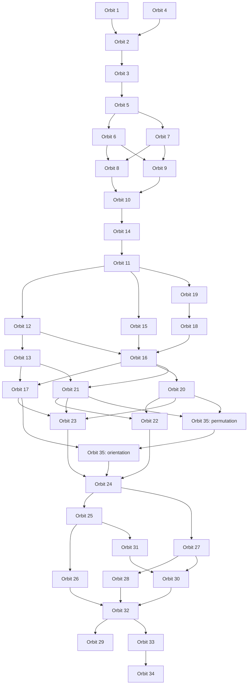

# Solver dependency graph

An arrow A -> B means the current algorithm for A may disturb B, so B must be solved afterward. These are dependencies of the selected algorithms, not immutable properties of the puzzle. A cleaner algorithm could remove an edge.

The graph below is the transitive reduction: it preserves all ordering requirements while hiding arrows already implied by longer paths. It is not the complete list of direct collateral effects.

Orbit 4 is a block containing positions -> C2 quotient -> C5 kernel. Orbit 35 is shown as two nodes: permutation first, orientation second. The chosen solver schedule keeps them adjacent. Other completed orbit solvers are shown as blocks to keep the diagram readable. Edges into35 distinguish position motion from pure reorientation, using exact labelled whole-piece maps.

Orbit 17 changes only corner orientations, so17 ->35.orientation is required, but17 ->35.permutation is not. Orbits20/21 move corners and must precede35.permutation. Both35 phases preserve23, so23 may also be interleaved where other constraints allow.

The alternate sequence35.permutation ->17 ->35.orientation was also tested from full-scramble colors: both orbits finish solved and colors outside permitted collateral remain unchanged. Reproduce with test_corner_phase_order.py; evidence is experiments/phase_order_35P_17_35O/summary.json.

## Direct collateral effects

| Solver | Position primitive changes | Orientation primitive changes |

|---|---|---|

| 1 | 2, 3, 5, 6, 7, 8, 9, 10, 11, 12, 13, 14, 15, 16, 17, 18, 19, 20, 21, 22, 23, 24, 25, 26, 27, 28, 29, 30, 31, 32, 33, 34, 35 | 2, 3, 5, 6, 7, 8, 9, 10, 11, 12, 13, 14, 15, 16, 17, 18, 19, 20, 21, 22, 23, 24, 25, 26, 27, 28, 29, 30, 31, 32, 33, 34, 35 |

| 2 | 3, 5, 6, 7, 8, 9, 10, 11, 12, 13, 14, 15, 16, 17, 18, 19, 20, 21, 22, 23, 24, 25, 26, 27, 28, 29, 30, 31, 32, 33, 34, 35 | Not needed |

| 3 | 5, 6, 7, 8, 9, 10, 11, 12, 13, 14, 15, 16, 17, 18, 19, 20, 21, 22, 23, 24, 25, 26, 27, 28, 29, 30, 31, 32, 33, 34, 35 | 5, 6, 7, 8, 9, 10, 11, 12, 13, 14, 15, 16, 17, 18, 19, 20, 21, 22, 23, 24, 25, 26, 27, 28, 29, 30, 31, 32, 33, 34, 35 |

| 4 | 2, 3, 5, 6, 7, 8, 9, 10, 11, 12, 13, 14, 15, 16, 17, 18, 19, 20, 21, 22, 23, 24, 25, 26, 27, 28, 29, 30, 31, 32, 33, 34 | 3, 5, 6, 7, 8, 9, 10, 11, 12, 13, 14, 15, 16, 17, 18, 19, 20, 21, 22, 23, 24, 25, 26, 27, 28, 29, 30, 31, 32, 33, 34, 35 |

| 5 | 6, 7, 8, 9, 10, 11, 12, 13, 14, 15, 16, 17, 18, 19, 20, 21, 22, 23, 24, 25, 26, 27, 28, 29, 30, 31, 32, 33, 34, 35 | Not needed |

| 6 | 8, 9, 10, 11, 12, 13, 14, 15, 16, 17, 18, 19, 20, 21, 22, 23, 24, 25, 26, 27, 28, 29, 30, 31, 32, 33, 34, 35 | Not needed |

| 7 | 8, 9, 10, 11, 12, 13, 14, 15, 16, 17, 18, 19, 20, 21, 22, 23, 24, 25, 26, 27, 28, 29, 30, 31, 32, 33, 34, 35 | Not needed |

| 8 | 10, 11, 12, 13, 14, 15, 16, 17, 18, 19, 20, 21, 22, 23, 24, 25, 26, 27, 28, 29, 30, 31, 32, 33, 34, 35 | Not needed |

| 9 | 10, 11, 12, 13, 14, 15, 16, 17, 18, 19, 20, 21, 22, 23, 24, 25, 26, 27, 28, 29, 30, 31, 32, 33, 34, 35 | 10, 11, 12, 13, 14, 15, 16, 17, 18, 19, 20, 21, 22, 23, 24, 25, 26, 27, 28, 29, 30, 31, 32, 33, 34, 35 |

| 10 | 11, 12, 13, 14, 15, 16, 17, 18, 19, 20, 21, 22, 23, 24, 25, 26, 27, 28, 29, 30, 31, 32, 33, 34, 35 | Not needed |

| 11 | 12, 13, 15, 16, 17, 18, 19, 20, 21, 22, 23, 24, 25, 26, 27, 28, 29, 30, 31, 32, 33, 34, 35 | Not needed |

| 12 | 13, 16, 17, 20, 21, 22, 23, 24, 25, 26, 27, 28, 29, 30, 31, 32, 33, 34, 35 | Not needed |

| 13 | 17, 21, 22, 23, 24, 25, 26, 27, 28, 29, 30, 31, 32, 33, 34, 35 | 17, 21, 22, 23, 24, 25, 26, 27, 28, 29, 30, 31, 32, 33, 34 |

| 14 | 11, 12, 13, 15, 16, 17, 18, 19, 20, 21, 22, 23, 24, 25, 26, 27, 28, 29, 30, 31, 32, 33, 34, 35 | 11, 12, 13, 15, 16, 17, 18, 19, 20, 21, 22, 23, 24, 25, 26, 27, 28, 29, 30, 31, 32, 33, 34, 35 |

| 15 | 16, 17, 20, 21, 22, 23, 24, 25, 26, 27, 28, 29, 30, 31, 32, 33, 34, 35 | Not needed |

| 16 | 17, 20, 21, 22, 23, 24, 25, 26, 27, 28, 29, 30, 31, 32, 33, 34, 35 | Not needed |

| 17 | 23, 24, 25, 26, 27, 28, 29, 30, 31, 32, 33, 34, 35 | Not needed |

| 18 | 16, 17, 20, 21, 22, 23, 24, 25, 26, 27, 28, 29, 30, 31, 32, 33, 34, 35 | Not needed |

| 19 | 16, 17, 18, 20, 21, 22, 23, 24, 25, 26, 27, 28, 29, 30, 31, 32, 33, 34, 35 | Not needed |

| 20 | 22, 23, 24, 25, 26, 27, 28, 29, 30, 31, 32, 33, 34, 35 | Not needed |

| 21 | 22, 23, 24, 25, 26, 27, 28, 29, 30, 31, 32, 33, 34, 35 | Not needed |

| 22 | 24, 25, 26, 27, 28, 29, 30, 31, 32, 33, 34 | 24, 25, 26, 27, 28, 29, 30, 31, 32, 33, 34 |

| 23 | 24, 25, 26, 27, 28, 29, 30, 31, 32, 33, 34 | Not needed |

| 24 | 25, 26, 27, 28, 29, 30, 31, 32, 33, 34 | Not needed |

| 25 | 26, 29, 30, 31, 32, 33, 34 | Not needed |

| 26 | 29, 32, 33, 34 | 29, 32, 33, 34 |

| 27 | 28, 29, 30, 32, 33, 34 | 28, 29, 30, 32, 33, 34 |

| 28 | 29, 32, 33, 34 | Not needed |

| 29 | None | Not needed |

| 30 | 29, 32, 33, 34 | Not needed |

| 31 | 29, 30, 32, 33, 34 | Not needed |

| 32 | 29, 33, 34 | Not needed |

| 33 | 34 | 34 |

| 34 | None | Not needed |

| 35 | 24, 25, 26, 27, 28, 29, 30, 31, 32, 33, 34 | 24, 25, 26, 27, 28, 29, 30, 31, 32, 33, 34 |

All 48 selected primitives were replayed on 259,800 unique sticker labels. Routing conjugates these primitives; every legal move preserves each piece orbit, so conjugation cannot introduce another collateral orbit. This gives an upper bound on each complete solver's collateral support even when a particular state happens to cause cancellations or no corrections.

The JSON evidence records exact changed-label counts and source-word hashes. Generous allowed_collateral configuration fields are permissions, not evidence of a dependency. In particular there is no 27 -> 31 edge, no 31 -> 28 edge, and no edge between 29 and 34.

Orbits20 and 21 are another independent reflection pair. The chosen20 word is the reflection of 21; it removes the 17 collateral present in the directly found20 candidate. Neither chosen solver disturbs17 or its mirror partner. Orbit 22 also preserves17,23,35 and has collateral only24..34.

There are 1774080 valid total orders for the current 35 solvers. The fully tested order is 1 -> 4 -> 2 -> 3 -> 5 -> 6 -> 7 -> 9 -> 8 -> 10 -> 14 -> 11 -> 12 -> 13 -> 19 -> 15 -> 18 -> 16 -> 20 -> 21 -> 22 -> 17 -> 35 -> 23 -> 24 -> 25 -> 26 -> 27 -> 31 -> 30 -> 28 -> 32 -> 33 -> 34 -> 29. Orbits 28 and 30 can be exchanged. The graph also allows other reorderings; only the listed complete order has been fully replayed as the full-chain regression.

When orbit 35 is split into its two phase nodes, there are 4377600 valid orders (other orbits remain blocks). The production order keeps35.permutation immediately followed by35.orientation. Phase-specific edges and evidence are stored separately from aggregate orbit edges in graph.json.

Orbits28/30 and 20/21 are reflection partners. Reflection pairing is a separate relationship and does not itself impose solve order. Unsupported orbits are excluded until their complete solvers are verified.

This release ships the frozen graph and selected algorithms; the exploratory graph-generation script remains in the separate research archive. The machine-readable graph is ../analysis/solver_dependencies/graph.json; the diagram is included above.

