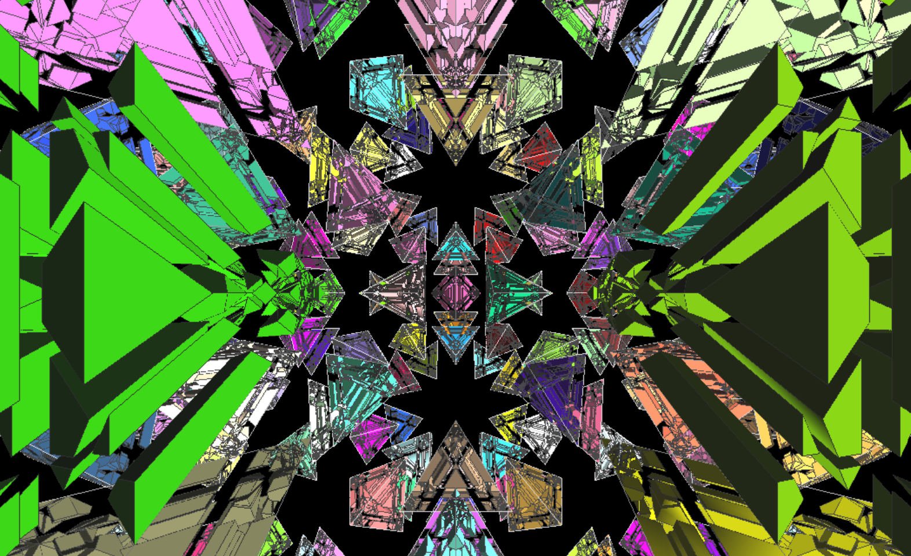
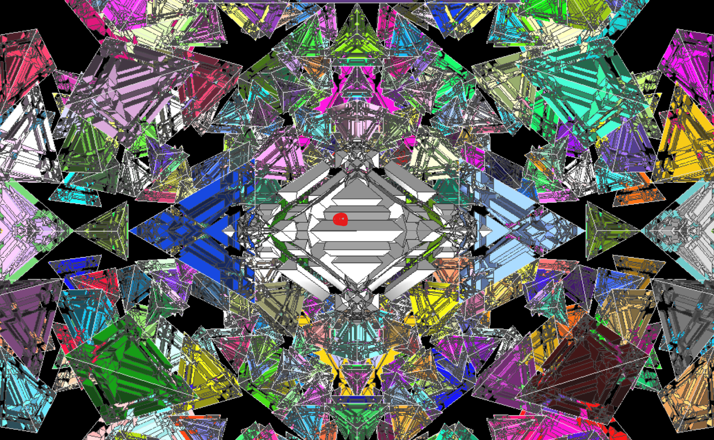

# Where to click when applying the macros

This is the reference point used in the successful MPUlt 1.55 full-solve tests. The screenshot was supplied by the user and is preserved unchanged.

## 1. Starting view after opening a log

If you load a `.log` file and see this view, hold the right mouse button and drag downward a little until the white cell emerges from behind the camera and comes into view. Sticker colors may differ from this example.

## 2. Ready to apply macros

MPUlt 1.55 has two different starting viewpoints, depending on how you enter the puzzle:

- **Selecting the full 600-cell from the puzzle menu, or starting the app with this puzzle automatically loaded:** the white cell is already at the front, centered in the view. The reference point is directly clickable; no view adjustment is needed.
- **Opening a `.log` file:** the viewpoint changes, and the white cell is initially out of sight. Hold the right mouse button and drag downward a little until the white cell emerges from behind the camera and comes into view, as in the screenshot. This is the view adjustment needed when loading a saved scramble for a generated solution.

Once the white cell is visible, locate its central horizontal edge. When applying a macro, use the spot marked in red: on the white cell, just above that edge and slightly to the left. The red mark is an annotation in this screenshot, not a marker supplied by MPUlt.

Use the same geometric reference point for every separate macro step. Match the cell and face geometry rather than a fixed screen coordinate; the camera position, window size and sticker colors may differ. Apply either the separate solution steps in order or the combined entry once, following the output README.

Future production output folders include a local copy named `macro_anchor.png`, so the instructions do not depend on this project folder or a temporary clipboard image. The screenshot is an essential usage reference to include in backups and a shared release.

