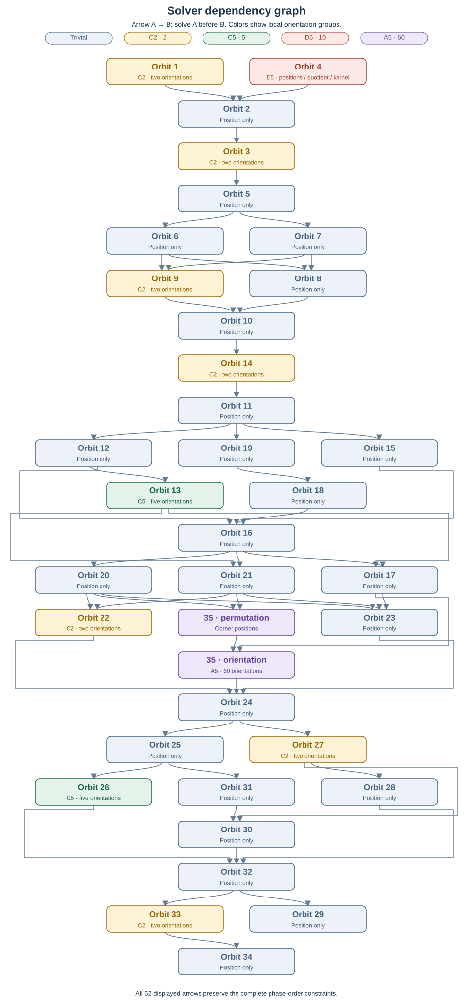

MPUlt · Full shallow-cut cell-turning 600-cell · Verified checkpoint: 28 October 2026


# The full 600-cell: counts, orientations and solving


**The color-only solver covers all 35 movable piece orbits.** A full solve has been verified in MPUlt: the separate-step save matches all 259,800 predicted sticker colors with a valid checksum. The user also reports a successful one-shot solve. Only the separate-step result was supplied for file comparison.


## 1. Counts at a glance


| Quantity | Count | Meaning |

| --- | --- | --- |

| Cells | 600 | Tetrahedral cells |

| Stickers per cell | 433 | Including its fixed center sticker |

| Total stickers | 259,800 | 600 × 433 |

| Total pieces | 177,120 | Sticker-bearing physical pieces |

| Movable pieces | 176,520 | Pieces whose position can change under legal turns |

| Fixed pieces | 600 | One cell-center piece per cell |

| Movable piece orbits | 35 | The orbit IDs 1–35 used by the solver |

| Movable sticker orbits | 41 | Sticker reachability classes, distinct from piece orbits |

| Piece orbits with nontrivial orientation | 11 | 26,520 movable pieces |

| Piece orbits with trivial orientation | 24 | 150,000 movable pieces |


A **piece** is the unit whose stickers travel together. A **sticker** is one colored location on a piece. A **movable piece orbit** is a set of piece positions connected by legal moves. All counts here refer to sticker-bearing puzzle pieces; unstickered internal material is outside this catalog.


If fixed positions are counted as singleton orbits, there are **635 piece orbits = 35 movable + 600 fixed**, and **641 sticker orbits = 41 movable + 600 fixed**. Geometrically the fixed cell centers form one kind of piece, but each is its own reachability orbit because it never changes position. Thus 35 and 41 are both correct, but count different objects.


## 2. Where the pieces are


| Location | Stickers per piece | All pieces | Movable pieces | Total stickers |

| --- | --- | --- | --- | --- |

| Within one cell | 1 | 107,400 | 106,800 | 107,400 |

| On a triangular face | 2 | 66,000 | 66,000 | 132,000 |

| On an original edge | 5 | 3,600 | 3,600 | 18,000 |

| At an original vertex / corner | 20 | 120 | 120 | 2,400 |

| TOTAL | — | 177,120 | 176,520 | 259,800 |


The one-sticker row includes all 600 fixed cell centers. There are **69,720 multi-sticker pieces**. The 600-cell has 1,200 triangular faces,720 edges and 120 vertices: 55 two-sticker pieces per face, five five-sticker pieces per edge, and one 20-sticker corner per vertex.


Along an original edge, the orbit order is **35 — 26 — 13 — 4 — 13 — 26 — 35**. Orbit 4 is the midpoint piece; 13 and 26 each contribute two off-center pieces per edge. Orbit 35 is the vertex/corner piece.


**Orbit 3 in the app: ** the user identified the relatively large stickers next to the orbit 1 face-center sticker. There are three orbit 3 stickers per triangular face as viewed from one cell. These correspond to three two-sticker pieces per original face: 3 × 1,200 = 3,600 physical pieces and 7,200 stickers across both incident cell sides.


## 3. Orientation groups and restrictions


A local orientation group counts the distinct permitted sticker arrangements of a piece **at a fixed position**. Its order includes the solved orientation. It does not count the places the piece can move to, and does not by itself imply that a single piece can be reoriented independently.


| Orbit IDs | Local group | Orientations per piece | Number of pieces | Structure / restriction |

| --- | --- | --- | --- | --- |

| 1, 3, 9, 14, 22, 27, 33 | C2 | 2 | 22,800 | Seven binary-flip orbits; even total flips within each orbit |

| 13, 26 | C5 | 5 | 2,880 | Two cyclic orbits; transported twist residues sum to 0 mod 5 in each orbit |

| 4 | D5 = C5 ⋊ C2 | 10 | 720 | Five rotations + five reflection-type arrangements; even total C2 quotient |

| 35 | A5 | 60 | 120 | Icosahedral rotation group; no nontrivial abelian orientation quotient |

| All other movable orbits | Trivial | 1 | 150,000 | 24 orbits; no separate orientation stage |


- **C2: ** a piece has solved/flipped states. A legal correction flips pairs within that orbit; it may disturb later orbits.

- **C5: ** rotations form a cyclic group of order 5. Twist bookkeeping uses consistent transported frames; isolated one-piece twists are not legal within these orbits.

- **D5 (orbit 4): ** this document uses D5 for the group of order 10. If r is a five-fold rotation and s is a reflection-type arrangement, r^5 = s^2 = 1 and srs = r^−1. The normal C5 subgroup contains rotations; the quotient D5/C5 is C2. Reflection-type arrangements come from legal 4D motions, not arbitrary physical mirror operations. The solver clears positions, then paired quotient bits, then independent C5 residues. A single five-fold rotation within orbit 4 is possible; a single quotient reflection is not.

- **A5 (orbit 35): ** the 60 proper rotations of the icosahedral vertex figure act on the corner’s 20 stickers. It is noncommutative. There is no scalar twist-sum condition analogous to C2/C5; the solver uses exact 60-element orientation maps. A correction can reorient one corner while preserving the other corners, with collateral confined to later orbits.


**Two stickers do not automatically imply a flip.** Orbits 10, 12, 16, 17, 24, 29 contain 43,200 two-sticker pieces in total, but their local orientation group is trivial. Legal geometry determines the allowed local maps.


Every elementary move induces an **even piece permutation within each of the 35 movable piece orbits**. Many pieces share the same visible colors, so the solver chooses a compatible even matching between indistinguishable copies. A color state must not be rejected merely because one arbitrary labeling has odd parity.


## 4. Strategy: from orbit analysis to a complete solve


**The objective is a deterministic procedure that finishes, with move count secondary.** The overall pattern is the familiar puzzle-solving approach of understanding the pieces, finding controlled algorithms, using setup moves, and repairing later piece types. The computer makes the searches and bookkeeping systematic.


**Analyze the puzzle structure.** First group stickers into physical pieces, then determine which piece positions are connected by legal moves. These are the movable piece orbits. For each orbit, establish its piece count, permitted local orientations and parity restrictions. This tells us what cases its solver must handle; sticker orbits alone do not provide that description.


**Identify pieces from the current colors.** Match the colors on each piece to the solved catalog, including the local arrangements permitted by its orientation group. Some physical pieces have indistinguishable colors. The solver chooses a consistent compatible matching between those copies; it does not need to recover which original physical copy arrived there. The input is the current color state and puzzle definition, with no scramble history or history-derived identities.


**For each orbit, first find useful algorithms.** Search for and verify building blocks such as a three-cycle, paired flips or twists, or a single-piece orientation change. Measure their exact effects, including effects on other orbits. An algorithm is useful when it preserves orbits that will be solved earlier; it may leave later orbits dirty. Finding one useful algorithm is the discovery phase, not yet a complete solver.


**Then turn the building blocks into a complete orbit solver.** Express the required position correction as a finite list of three-cycles. Use routing to apply the known three-cycle wherever it is needed. Routing constructs setup moves: move the selected three pieces to the algorithm’s working positions in the required order, apply the algorithm, and undo the setup. The resulting action is a conjugate of the original algorithm. Setup moves may temporarily move many other pieces; undoing the setup leaves the transported algorithm’s effect, including its permitted collateral effects.


**Finish the orientations.** After positions are solved, inspect the actual resulting colors again and apply the orientation method appropriate to that orbit. This may mean paired flips, coupled cyclic twists, or exact single-piece orientation corrections. Reorientation uses the same setup/apply/undo pattern, while tracking how the setup changes the local orientation frame. Trivial-orientation orbits need no separate correction; orbit 4 uses positions → C2 quotient → C5 kernel, and orbit 35 uses positions → exact 60-state orientation corrections.


**Establish coverage, not just examples.** A complete orbit solver must be able to route every required triple or orientation target, handle every permitted orientation case, and preserve the earlier completed orbits. Exact move checks, broad state tests and application comparisons support these claims. An isolated three-cycle or a successful small example does not establish complete coverage by itself.


**Integrate the orbit solvers.** Record which later orbits each selected algorithm can disturb, build the dependency graph, and choose a valid order. Starting from the supplied colors, solve the first orbit, pass its resulting state into the next solver, and continue. At every stage, check that previously completed orbits remain solved. The pipeline emits the 35 orbit steps and their combined macro. The remaining dirty orbits are deliberately repaired later, until the entire puzzle is solved.


**Why the process terminates.** Each orbit’s position correction becomes a finite list of three-cycles, and its remaining orientations become a finite list of corrections. Every routed correction has a finite setup and undo sequence. The dependency order prevents later stages from spoiling earlier results. Once the algorithms and routing tables exist, a new solve requires no new algorithm discovery or discretionary choices: deterministic scripts perform the state identification, planning and move generation without an LLM.


## 5. Dependencies: what must come before what


**An arrow A → B means the selected solver for A can disturb B, so solve B afterward.** These are dependencies of the chosen algorithms, not immutable geometric properties. The full aggregate graph has 564 direct collateral edges. The diagram shows a transitive reduction: redundant arrows are hidden without changing any required ordering.


Orbit 35 is split into permutation and orientation because some earlier algorithms disturb only corner orientation. Orbit 4 remains one block containing its three internal phases. The diagram has 36 nodes and 52 arrows. The corresponding 35-block reduction has 51 arrows.





[Full-size graph](overview/dependencies.svg) · [PNG copy](overview/dependencies.png)


The graph is **not a single chain**. For example 1 and 4 can be exchanged; 6 and 7 can be exchanged; 8 and 9 can be exchanged. Other branches allow additional reorderings when all incoming dependencies are satisfied. There are 1,774,080 valid 35-block orders for these selected algorithms. With 35 split as shown, there are 4,377,600 valid orders; other orbit solvers remain blocks in that count.


Orbit 17 changes corner orientations but not corner positions. Therefore 17 must precede 35.orientation, while 35.permutation can precede 17. The alternate order 35.permutation → 17 → 35.orientation has also passed a model composition test. The production order keeps both 35 phases adjacent for convenience.


## 6. Tested solve order and all 35 orbit counts


The order below is the production order validated on the full scramble in MPUlt. **Orbit IDs are catalog labels, not solve-step numbers.** Each orbit is one user-facing macro step, even when it contains multiple internal phases. There are 35 steps and 47 internal phases; a 36th macro entry concatenates all 35 steps.


| Step | Orbit | Pieces | Stickers / piece | Orientation group | Internal phases |

| --- | --- | --- | --- | --- | --- |

| 1 | 1 | 1,200 | 2 | C2 | Positions → paired flips |

| 2 | 4 | 720 | 5 | D5 | Positions → C2 quotient → C5 kernel |

| 3 | 2 | 3,600 | 1 | Trivial | Positions |

| 4 | 3 | 3,600 | 2 | C2 | Positions → paired flips |

| 5 | 5 | 2,400 | 1 | Trivial | Positions |

| 6 | 6 | 7,200 | 1 | Trivial | Positions |

| 7 | 7 | 7,200 | 1 | Trivial | Positions |

| 8 | 9 | 3,600 | 2 | C2 | Positions → paired flips |

| 9 | 8 | 7,200 | 1 | Trivial | Positions |

| 10 | 10 | 7,200 | 2 | Trivial | Positions |

| 11 | 14 | 3,600 | 2 | C2 | Positions → paired flips |

| 12 | 11 | 7,200 | 1 | Trivial | Positions |

| 13 | 12 | 7,200 | 2 | Trivial | Positions |

| 14 | 13 | 1,440 | 5 | C5 | Positions → cyclic twists |

| 15 | 19 | 2,400 | 1 | Trivial | Positions |

| 16 | 15 | 7,200 | 1 | Trivial | Positions |

| 17 | 18 | 7,200 | 1 | Trivial | Positions |

| 18 | 16 | 7,200 | 2 | Trivial | Positions |

| 19 | 20 | 7,200 | 1 | Trivial | Positions |

| 20 | 21 | 7,200 | 1 | Trivial | Positions |

| 21 | 22 | 3,600 | 2 | C2 | Positions → paired flips |

| 22 | 17 | 7,200 | 2 | Trivial | Positions |

| 23 | 35 | 120 | 20 | A5 | Permutation → 60-state orientation |

| 24 | 23 | 7,200 | 1 | Trivial | Positions |

| 25 | 24 | 7,200 | 2 | Trivial | Positions |

| 26 | 25 | 7,200 | 1 | Trivial | Positions |

| 27 | 26 | 1,440 | 5 | C5 | Positions → cyclic twists |

| 28 | 27 | 3,600 | 2 | C2 | Positions → paired flips |

| 29 | 31 | 2,400 | 1 | Trivial | Positions |

| 30 | 30 | 7,200 | 1 | Trivial | Positions |

| 31 | 28 | 7,200 | 1 | Trivial | Positions |

| 32 | 32 | 7,200 | 1 | Trivial | Positions |

| 33 | 33 | 3,600 | 2 | C2 | Positions → paired flips |

| 34 | 34 | 2,400 | 1 | Trivial | Positions |

| 35 | 29 | 7,200 | 2 | Trivial | Positions |


At every step the script checks that all previously completed orbits remain solved. The final state solves 259,200 movable stickers and preserves the 600 fixed centers, giving 259,800 solved colors overall. Input is the puzzle definition and sticker colors; scramble and undo history are excluded from solving.


## 7. Reflection pairs and validation


The verified reflection-related orbit pairs are **6 ↔ 7, 15 ↔ 18, 20 ↔ 21, 28 ↔ 30**. All other movable piece orbits map to themselves under the tested coordinate reflection. This is a geometric relationship useful for reusing algorithms; it does not automatically imply interchangeable solve order, nor by itself prove intrinsic chirality of individual piece shapes.


The model passed full solves from two observed full scrambles. The production solution for the exact original full_scramble_02.log contains **7,985,585 moves**. The user ran both the separate steps and the combined macro, and MPUlt recognized both as solving a 12,000-twist scramble. The supplied separate-step save matches every 259,800 predicted color and has a valid checksum; the combined solve is user-reported, without a supplied combined save. This is end-to-end validation on this scramble, not an exhaustive actual-app test of all possible states.


Additional application validation: the user independently ran the production CLI on the original full_scramble.log, applied the 35 steps, and reports a solved puzzle. That solution contains 7,943,906 moves. No saved result file was supplied for comparison for this run; it is recorded as a user-reported application success, separately from the file-verified second scramble.


**Independent post-development validation: ** after the solver was complete, the user created a fresh full scramble in MPUlt, saved full_scramble_03.log, ran the production Python command independently, and applied all 35 macro steps. The puzzle solved. Its saved result matches every 259,800 predicted color exactly with valid checksum. The solution uses 7,982,494 moves; the engine and dependency-graph hashes match the previous validated package. This tests the complete workflow on a new scramble that was not used during solver development.


Current algorithms prioritize deterministic completion over short solutions. The full pipeline is reusable without an LLM:


```text

python solve.py INPUT.log --output NEW_DIRECTORY

```


## 8. Applying macros: the reference point


The macro reference point is part of the usage instructions. This screenshot, supplied by the user, marks the spot used in the successful MPUlt solves. Bring the white cell into the shown orientation and use the red-marked spot just above the central horizontal edge, slightly to the left.


The red mark is the user’s annotation, not an app-provided marker. Match the cell geometry rather than fixed screen coordinates; sticker colors, camera scale and window size may differ. Use the same reference point for every separate macro step. Future generated solution folders contain their own copy of this screenshot, named macro_anchor.png. See the [reference-point guide](MACRO_ANCHOR.md).


## 9. Data and detailed references


- [Current solver status](VALIDATION.md) — validation details and limitations.

- [Detailed dependencies](DEPENDENCIES.md) — exact collateral tables and graph explanation.

- [Piece locations and groups](PIECES.md) — geometry, edge intervals and orientation reference.

- [CLI usage](../README.md) — generating and applying solution files.

- [Independent fresh-scramble validation](VALIDATION.md) — new post-development scramble, complete workflow and exact saved-file comparison.

- [Application validation](VALIDATION.md) — saved-file comparison and user-reported combined solve.

- [Piece counts](../analysis/pieces/summary.json), [orientation groups](../analysis/pieces/orientation_groups.tsv), [dependency data](../analysis/solver_dependencies/graph.json) — machine-readable source data.


This overview was generated from the verified research catalogs and dependency graph. The report generator remains in the separate research archive; this release includes the rendered report and source tables. Its diagrams and tables add no new solver assumptions. HTML is a self-contained reading copy; Markdown is the editable project reference.

